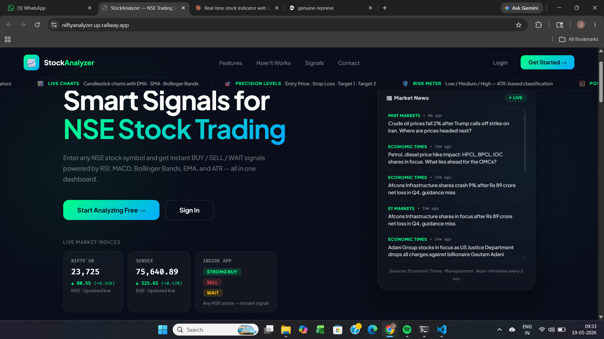
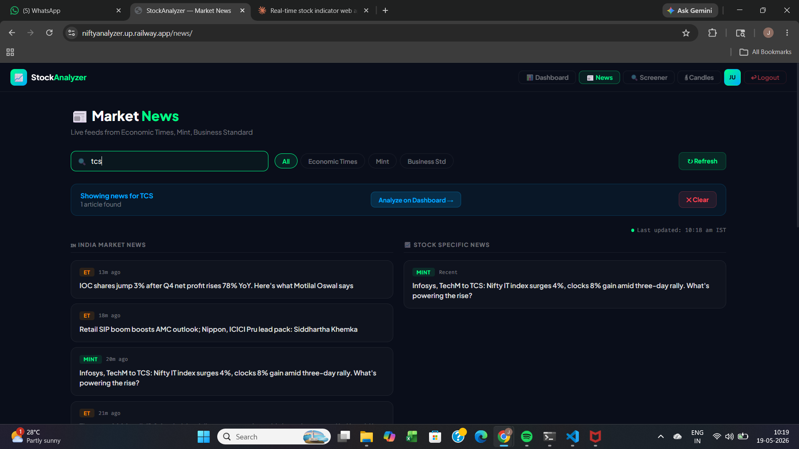
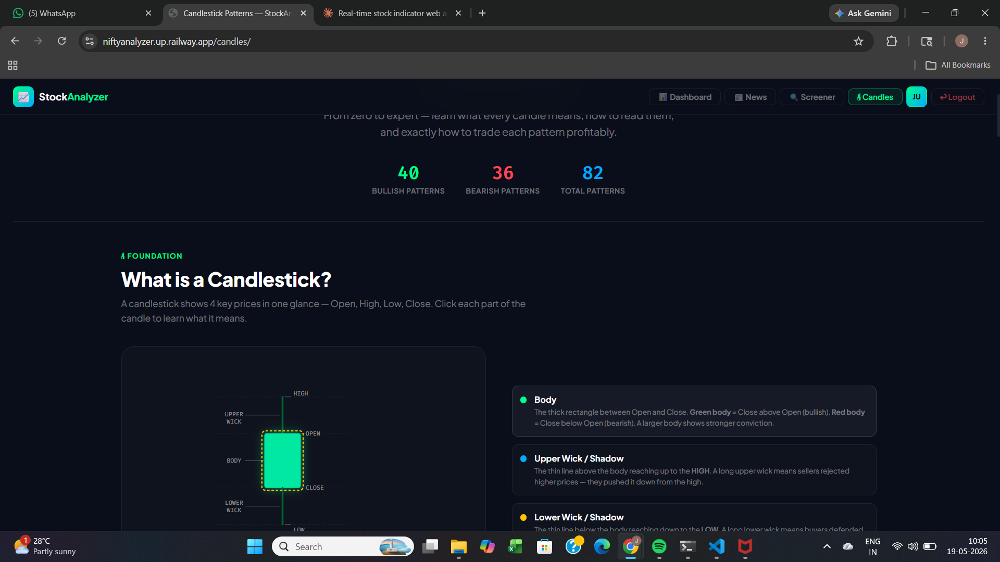
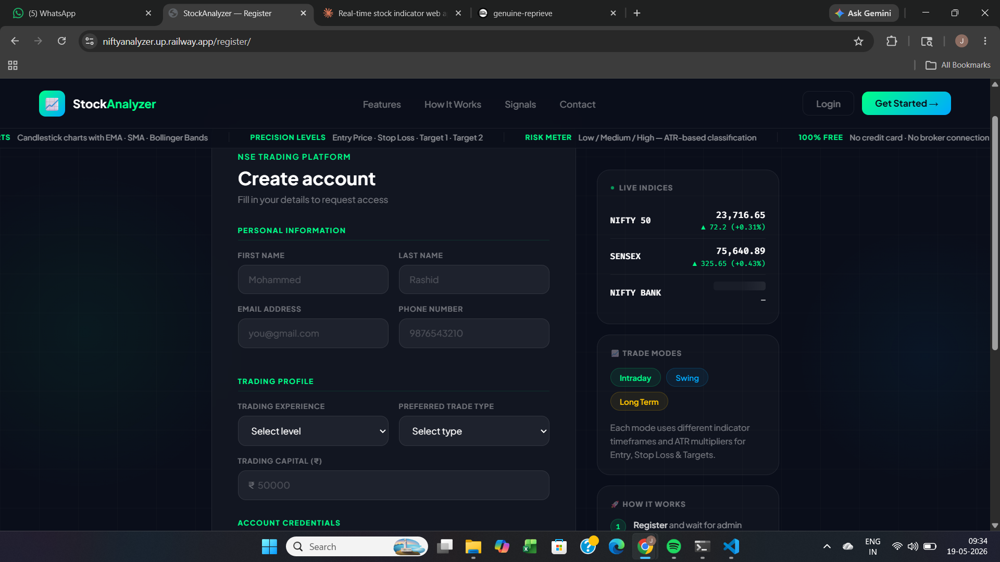

# 📈 StockAnalyzer — NSE India Trading Platform

> Real-time NSE stock analysis with AI-powered BUY/SELL signals, live Upstox price feeds, candlestick pattern detection, and plain English explanations for every trader.


---

## 🌐 Live Demo

**[https://niftyanalyzer.up.railway.app](https://niftyanalyzer.up.railway.app)**

---

## 📸 Screenshots

### 🏠 Landing Page


### 📊 Dashboard — Live Trading Analysis


### 📰 Market News


### 🕯 Candlestick Pattern Library


### 📝 Register


---

## ✨ Features

### 📊 Live Trading Dashboard
- Real-time candlestick chart powered by **LightweightCharts v4.2**
- Live price updates every 2 seconds via **Upstox API**
- Timeframes: **1m / 5m / 15m / 1h / 1D / 1W**
- **EMA 9/21**, Bollinger Bands, Support/Resistance lines on chart
- Live price line that moves with current market price
- Volume histogram with color coding
- Pattern markers directly on chart candles

### ⚡ AI-Powered Signals
- **STRONG BUY / BUY / WAIT / SELL / STRONG SELL** signals
- Bull vs Bear percentage meter
- Trade type scores — **Intraday / Swing / Long Term** (0-100%)
- Risk level — **LOW / MEDIUM / HIGH** based on ATR
- Entry price, Stop Loss, Target 1/2/3 with % change
- Risk:Reward ratio calculation
- Position size calculator based on your capital

### 🕯 Candlestick Pattern Detection
- Auto-detects **13+ patterns** from live candle data
- Doji, Hammer, Shooting Star, Engulfing, Morning Star, Evening Star
- Marubozu, Three White Soldiers, Three Black Crows and more
- Confidence score for each detected pattern
- Shows exactly where pattern was detected (latest candle / N candles ago)
- **100+ pattern education library** with interactive SVG diagrams

### 📖 Plain English Explanation
- Every indicator explained in simple language after each analysis
- Chart reading in plain English — what the trend is, where price is
- What each indicator means **right now** for that specific stock
- Pattern meanings and exact trading action to take
- Support/Resistance explained with % distance from current price
- Final verdict with entry/stop loss/target in plain text

### 📰 Market News
- Live feeds from **Economic Times, Mint, Business Standard**
- Search stock-specific news by symbol
- Auto-refreshes every 5 minutes
- Filter by news source
- One-click analyze from news to dashboard

### 🏠 Landing Page
- Live Nifty 50 and Sensex prices
- Live market news feed
- Feature showcase with scrolling ticker
- Direct register and login

### 👤 User Profile
- Signal history and analysis count
- Most analyzed stocks ranking
- Buy/Sell/Wait signal breakdown
- Most active trading day
- Watchlist overview
- Edit trading preferences and capital

### 🔐 Admin Panel
- User management — approve / reject / deactivate
- Full signal history across all users
- Activity log with IP tracking
- Top analyzed stocks
- Cache management

---

## 🛠 Tech Stack

| Layer | Technology |
|-------|-----------|
| Backend | Django 5.0, Python 3.12 |
| Database | PostgreSQL (Railway) / SQLite (local) |
| Real-time Data | Upstox API (live tick) |
| Market Data | yfinance, Finnhub (fallback) |
| Indicators | `ta` library — RSI, MACD, BB, EMA, SMA, ATR |
| Charts | LightweightCharts v4.2 |
| Frontend | Vanilla JS, CSS Variables, Plus Jakarta Sans |
| Hosting | Railway.app |
| Static Files | WhiteNoise |
| News | RSS feeds — ET, Mint, Business Standard |

---

## 📦 Local Setup

### Prerequisites
- Python 3.12+
- pip
- Git

### Installation

```bash
# Clone the repository
git clone https://github.com/justin-0/stock-analyzer.git
cd stock-analyzer

# Create virtual environment
python -m venv venv

# Activate (Windows)
venv\Scripts\activate

# Activate (Mac/Linux)
source venv/bin/activate

# Install dependencies
pip install -r requirements.txt

# Create .env file
cp .env.example .env
# Edit .env and add your API keys

# Run migrations
python manage.py migrate

# Create admin user
python manage.py createsuperuser

# Collect static files
python manage.py collectstatic --noinput

# Start server
python manage.py runserver
```

Open `http://127.0.0.1:8000` in your browser.

---

## 🔑 Environment Variables

Create a `.env` file in the root directory:

```env
SECRET_KEY=your-django-secret-key-here
DEBUG=True

# Market Data APIs
FINNHUB_API_KEY=your-finnhub-api-key
UPSTOX_ACCESS_TOKEN=your-upstox-access-token
ALPHA_VANTAGE_KEY=your-alpha-vantage-key

# Cache (seconds)
CACHE_TIMEOUT=300
```

### Getting API Keys

| API | Where to get | Free tier |
|-----|-------------|-----------|
| **Upstox** | [upstox.com](https://upstox.com) → Developer → API | Yes — real-time NSE data |
| **Finnhub** | [finnhub.io](https://finnhub.io) | Yes — 60 calls/min |
| **Alpha Vantage** | [alphavantage.co](https://www.alphavantage.co) | Yes — 25 calls/day |

---

## 📁 Project Structure

```
stock-analyzer/
├── stockanalyzer/              # Django project
│   ├── settings.py             # Configuration
│   ├── urls.py                 # Main URL routing
│   └── wsgi.py                 # WSGI entry point
│
├── stocks/                     # Main application
│   ├── models.py               # UserProfile, Watchlist, SignalHistory, ActivityLog, StockCache
│   ├── views.py                # All views and API endpoints
│   ├── utils.py                # Market data, indicators, signals, pattern detection
│   └── urls.py                 # App URL routing
│
├── templates/
│   └── stocks/
│       ├── home.html           # Landing page
│       ├── login.html          # Login page
│       ├── register.html       # Registration page
│       ├── dashboard.html      # Main trading dashboard
│       ├── news.html           # Market news page
│       ├── candles.html        # 100+ pattern education
│       ├── profile.html        # User profile
│       ├── _navbar.html        # Shared navbar component
│       ├── _navbar_styles.html # Shared navbar CSS
│       ├── admin_dashboard.html
│       ├── admin_users.html
│       ├── admin_user_detail.html
│       ├── admin_signals.html
│       └── admin_activity.html
│
├── static/
│   └── js/
│       ├── main.js             # Dashboard logic — chart, signals, live price
│       └── candle_patterns.js  # 100+ pattern data with visuals
│
├── screenshots/                # App screenshots for README
├── Procfile                    # Railway deployment command
├── runtime.txt                 # Python version for Railway
├── requirements.txt            # Python dependencies
└── .env.example                # Environment variables template
```

---

## 🔌 API Endpoints

| Endpoint | Method | Description |
|----------|--------|-------------|
| `/api/analyze/` | GET | Full stock analysis — quote, indicators, signal, patterns, S/R |
| `/api/candles/` | GET | Candlestick OHLCV data for any timeframe |
| `/api/live-price/` | GET | Real-time price via Upstox (updates every 2s) |
| `/api/market/` | GET | Nifty, Sensex, VIX live data |
| `/api/watchlist/` | POST | Add/remove from watchlist |
| `/api/watchlist/signals/` | GET | All watchlist stocks with signals |
| `/api/stock-news/` | GET | Stock-specific news from RSS feeds |
| `/api/news/` | GET | General market news |
| `/api/screener/` | GET | 20-stock screener with signals |

---

## 📊 Supported NSE Stocks

**Real-time Upstox data** (50+ stocks):
```
RELIANCE  TCS       INFY      HDFCBANK  ICICIBANK
SBIN      WIPRO     BAJFINANCE MARUTI   TATAMOTORS
AXISBANK  KOTAKBANK HINDUNILVR BHARTIARTL ITC
ONGC      NTPC      SUNPHARMA  ADANIENT  HCLTECH
LT        TATASTEEL TITAN      IRCTC     DRREDDY
CIPLA     DIVISLAB  APOLLOHOSP HAVELLS   DABUR
```

**All other NSE stocks** — supported via yfinance fallback (5000+ stocks).

---

## 🚀 Deployment

### Deploy to Railway

1. Fork this repository
2. Go to [railway.app](https://railway.app)
3. New Project → Deploy from GitHub
4. Add PostgreSQL database
5. Add environment variables
6. Set start command:

```
python manage.py migrate && python manage.py collectstatic --noinput && gunicorn stockanalyzer.wsgi:application --bind 0.0.0.0:$PORT
```

Railway auto-deploys on every push to `main` branch.

### Environment Variables on Railway

Add all variables from `.env.example` in Railway → Variables tab.
Railway automatically provides `DATABASE_URL` when PostgreSQL is added.

---

## 📈 How Signals Work

```
RSI < 30        → +3 bull points (oversold)
RSI < 45        → +1 bull points
RSI > 70        → +3 bear points (overbought)
RSI > 55        → +1 bear points

MACD diff > 0   → +2 bull points
MACD diff < 0   → +2 bear points

EMA9 > EMA21    → +2 bull points (golden cross)
EMA9 < EMA21    → +2 bear points (death cross)

Price > SMA50   → +1 bull points
Price > SMA200  → +1 bull points

Price ≤ BB Lower → +2 bull points (at support)
Price ≥ BB Upper → +2 bear points (at resistance)

Volume Spike    → +1 to leading side

STRONG BUY  = bull ≥ 8 points
BUY         = bull ≥ 5 points
STRONG SELL = bear ≥ 8 points
SELL        = bear ≥ 5 points
WAIT        = mixed signals
```

---

## ⚠️ Disclaimer

This tool is for **educational and informational purposes only**.

- Not financial advice
- Past signals do not guarantee future results
- Always do your own research before trading
- The developer is not responsible for any trading losses
- Trading involves substantial risk of loss

---

## 👨‍💻 Developer

**Justin** — [@justin-0](https://github.com/justin-0)

Built with ❤️ for Indian retail traders.

---

## 📄 License

Private repository — All rights reserved.

Not open source. Do not copy, distribute, or use without permission.